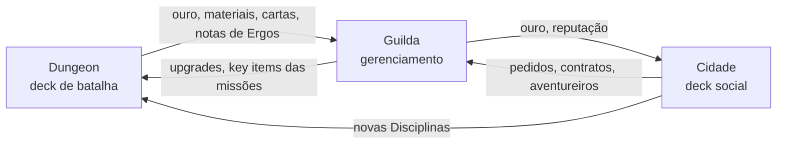

# Dragão Amarelo

*Documento de design preliminar · v0.53 · rascunho para editar*

**Como usar este documento**
- Texto com `(Pn)` é decisão tomada; o número aponta a pergunta de origem.
- Blocos `[!question]` são perguntas em aberto. Responda no arquivo ou no chat citando o número.
- Blocos `[!tip]` são sugestões minhas e `[!warning]` são riscos. Apague sem dó.
- `[A DEFINIR]` marca lacunas menores.

## Visão geral

| Tema | Decisão | Ref. |
|---|---|---|
| Plataforma | Digital, single-player, PC | P17 |
| Tom | Comédia leve com momentos sérios e dramáticos | P1 |
| Protagonista | Nome criado pelo jogador, passado não especificado; luta sozinho | P2, P7 |
| Poder herdado | Ao entrar na dungeon, ganha um poder que canaliza as Disciplinas; vale na dungeon e arredores (cidade). Vem do sangue: Ergos abriu a dungeon com o próprio sangue, e só a família dele pode terminá-la | Extra, P33 |
| Disciplinas no mundo | Existem pelo mundo; só quem está ligado à dungeon luta como o protagonista | P33b |
| História | Os 20 andares fecham o resgate de Ergos; o mistério do problema terminal continua. Resgatado, Ergos vira NPC na guilda | P43, P46 |
| Dungeon | Campanha persistente; cada andar é um mapa com caminhos e eventos, gerado a cada descida; uma descida por dia = um andar; tema muda por andar ou grupo de andares; só o protagonista tem acesso | P6, P9, P37, P41 |
| Vida no andar | Carrega entre as lutas, com recuperação parcial | P41 |
| Campanha | 20 andares para começar, com espaço para expandir; chefe no fim de cada grupo temático, elites fecham os demais; descida de 15 a 25 min | P42 |
| Derrota na dungeon | Volta com recompensa bem reduzida; no dia seguinte recomeça do início do andar | P8 |
| Revisitas | Monstros repovoam com outra composição e mesma dificuldade; só a primeira vitória dá recompensas de poder | P20 |
| Recurso | Mana clássica | P5 |
| Run de um andar | Mapa em grafo (6 linhas + nó final); vida carrega com +6 por vitória; cartas ganhas vão para a mochila e só entram na coleção ao concluir o andar; o deck só é editado na guilda, entre descidas | P60, P61, P62 |
| Boosters e raridade | Comum, Incomum, Rara; booster de 5 cartas. Fim de andar (1ª vez): booster do andar, geral com 2 cartas garantidas da Disciplina do deck. Boosters só de uma Disciplina: com os Mestres, na cidade | P59, P67, P73 |
| Mulligan | Troca da mão inteira; a 1ª troca é grátis e cada uma seguinte vem com 1 carta a menos | P55 |
| Vida do protagonista | 30 | Seção 5 |
| Decks | Batalha: 30 cartas, até 2 cópias. Social: 20 cartas, até 2 cópias | P47 |
| Deck inicial | 20 neutras fixas + seleção introdutória de 10 cartas da Disciplina escolhida | P53 |
| Neutras | Felinos da Guilda (gatos companheiros), equipamentos, armas e táticas mundanas; excepcionais (golem, criatura lendária) depois | P53 |
| Permanentes | Estruturas têm Vida e podem ser atacadas; Rituais e Armadilhas só saem por efeitos | P49 |
| Poder heroico | Não existe; no lugar, Evolução (no molde da do SV, só em unidades) ligada ao poder herdado (antes Ressonância) | P38, P39, P58 |
| Turno inicial | O jogador sempre começa | P39 |
| Chefes | Só no fim de cada grupo; únicos inimigos que evoluem | P40, P42 |
| Inimigos | Modelo HS: líder com Vida, deck e mana, mais uma Regra passiva | P50 |
| Grupo 1 | Grutas Vivas: caverna natural com fungos e bichos; chefe: Basilisco das Grutas | P51, P52 |
| Campo | Gama completa do gênero; o deck define a mistura | P18 |
| Disciplinas | 6 + Neutras; uma Disciplina por deck, sem mistura; começa com 1 (tutorial); novas via mestres na cidade; também dão cartas sociais | P21, P29, P31, P32, P12 |
| Deck social | Mesma engine da batalha, outro vocabulário; a mesma Disciplina do deck de batalha; deck inicial com 14 neutras fixas + 6 introdutórias (P54); batalha só em algumas visitas a NPC e, raramente, em eventos da dungeon | P10, P35, P41b, P44 |
| Tempo | 1x por dia cada: descer na dungeon, visitar um NPC, despachar missões, construir/melhorar. Defesas são eventos e não gastam ação | P4, P34, P34b |
| Guilda | Gerenciamento leve; renda vem de pedidos de clientes e do governo | P13, P14 |
| Aventureiros | Não lutam; missões de despacho (maioria automática); falha = sem recompensa + 1 dia de recuperação | P19, P22, P25 |
| Defesas | Físicas (ladrões, monstros) com deck de batalha, só com o protagonista em casa, derrota = sem recompensa + multa. Sociais (golpistas, extorsão, rivais) com deck social | P11, P24, P26, P27 |
| Dívida | Parcelas a cada 7 dias; atraso acumula juros sem game over; quitação obrigatória para avançar no fim | P3, P28, P34b |
| Credor | Banqueiro nobre do governo; oponente social forte | P30 |
| Anti-espiral | Renegociação social reduz a taxa; renda sempre disponível | Seção 2 |
| Felix | Narrador/tutor + carta neutra | P15 |

---

## 1. Premissa e mundo

**Cenário:** fantasia medieval. **Tom (P1):** comédia leve com momentos sérios e dramáticos.

**Gancho:** o protagonista herda do tio, recém declarado morto (desaparecido), três coisas: uma dívida substancial, um estabelecimento e as licenças para operar a guilda de aventureiros **Dragão Amarelo**.

**Protagonista (P2):** nome escolhido pelo jogador, passado não especificado. Luta sozinho (P7).

**Ergos, o tio (P16):** homem de boa índole, teimoso, inteligente e excêntrico; classe não especificada. Deixou anotações sobre suas teorias e experiências espalhadas pela dungeon. Queria chegar ao fim dela porque suspeitava que o segredo lá embaixo resolveria o problema terminal do mundo.

**Felix:** familiar de Ergos, um gato alado que se revela quando o protagonista chega. Explica que Ergos não morreu: desceu na dungeon e ficou preso, e o governo não entende isso. A guilda já ia mal; Ergos tentou reerguê-la com o que coletasse lá embaixo, sem sucesso. Felix passa a missão de resgate e conduz os tutoriais. Também existe como carta neutra (P15).

**A dungeon (P9):** um buraco no subsolo do estabelecimento leva a uma dungeon impossivelmente longa e profunda, cheia de tesouros e magia poderosa. O tema muda por andar ou grupo de andares. Só o protagonista tem acesso; outras guildas não.

**O poder herdado (Extra):** ao entrar na dungeon, o protagonista herda um poder especial que permite canalizar as Disciplinas e se tornar poderoso. Ele funciona na dungeon e nos arredores (a cidade), o que explica por que o protagonista só luta ali.

> [!tip] Notas de Ergos
> As anotações podem ser colecionáveis por andar: contam a história, dão pistas do problema terminal e às vezes ensinam algo útil (dica de chefe, uma carta, um atalho). Bom fio condutor para a campanha persistente.

**Origem (P33):** sangue. Ergos usou o próprio sangue para abrir a dungeon, e agora só a família dele pode terminá-la. Isso explica o acesso exclusivo (P9) e o poder do protagonista lá dentro.

**Disciplinas no mundo (P33b):** as Disciplinas existem pelo mundo e os mestres as praticam normalmente. Só quem está ligado à dungeon luta do jeito do protagonista.

> [!tip] O formato de card game como magia da dungeon
> Isso dá uma justificativa dentro do mundo para o próprio formato: invocar unidades, mana crescente e Evolução são o jeito como a dungeon deixa o sangue de Ergos lutar. Os mestres ensinam a Disciplina; a dungeon a transforma em cartas. Também explica as cartas sociais: elas vêm do lado comum das Disciplinas (presença, conhecimento, técnica).

**Família (P45):** sem outros parentes planejados por enquanto; a porta fica aberta se o plot pedir. [A DEFINIR: a dungeon estava selada embaixo da guilda por acaso, ou Ergos comprou o prédio por causa dela?]

> [!question] P36: O problema terminal do mundo [A DEFINIR, sem pressa]
> O que é? O mundo sabe dele ou só Ergos suspeitava?
>
> 💡 Com P43, o primeiro arco só precisa insinuar o problema pelas notas de Ergos; a resposta pode ficar para depois.

**Escopo (P43):** os 20 andares fecham o resgate de Ergos; o mistério do problema terminal continua além deles.

**Depois do resgate (P46):** Ergos vira NPC na guilda, como mentor ou mestre.

> [!tip] Ergos como mestre
> Ele pode ensinar algo que nenhum outro mestre ensina (uma Disciplina rara ou versões avançadas), ligando o pós-resgate ao mistério que continua.

---

## 2. Loop, tempo e dívida

1. Desce na **dungeon**: ouro, materiais, cartas, relíquias e notas de Ergos.
2. Investe na **guilda**: instalações, aventureiros, upgrades, parcelas da dívida.
3. Negocia na **cidade**: pedidos de clientes, recrutamento, Disciplinas novas com os mestres.
4. Volta à dungeon mais forte e desce mais fundo.

### Dia (P4)

Cada **tipo** de ação importante pode ser feito uma vez por dia (P4, P34, P34b). Em algum momento o jogador passa o dia para continuar.

- **Ações importantes (1x por dia cada):** descer na dungeon, visitar um NPC, despachar missões, construir ou melhorar instalação.
- **Defesas** (físicas e sociais) chegam como eventos e não gastam ação.
- **Ações livres** [A DEFINIR, sugestão]: montar deck, ler notas de Ergos, falar com Felix, pagar parcela.

Regras que já usam o dia: derrota na dungeon recomeça o andar no dia seguinte (P8); aventureiro que falha passa 1 dia se recuperando (P25).

> [!tip] A decisão diária
> Com uma visita a NPC por dia, credor, mestres, clientes, mercadores e recrutamento disputam o mesmo espaço. É aí que mora a escolha interessante de cada dia.

**Visitas (P44):** só algumas envolvem batalha social; comprar, por exemplo, é direto. [A DEFINIR: clientes vão à guilda como evento, ou o jogador precisa visitá-los?]

### Dívida (P3, P28, P30)

- Parcelas a cada 7 dias (P34b): cerca de 5 vencimentos numa campanha de 30 a 40 dias. Atrasar não encerra o jogo, só acumula juros (e aumenta o grind). Mais para o final, a dívida precisa estar quitada para prosseguir.
- **Credor (P30):** banqueiro nobre do governo. Faz o trabalho dele sem se preocupar em ser agradável, sempre atento a subterfúgios do protagonista e de todos que precisa cobrar. Não é maligno, mas sempre espera o pior de todos. Oponente social forte.
- **Anti-espiral:** renegociação social com o credor reduz a taxa; uma fonte de renda está sempre disponível.

> [!tip] Licenças como trava final
> A premissa já justifica a quitação obrigatória: renovar a licença da guilda (ou obter a que libera as camadas mais fundas) exige estar sem dívidas.

> [!tip] O credor em mesa
> O perfil "espera o pior de todos" vira mecânica: táticas de engano (blefe, distração) custam caro ou são reveladas contra ele, e o jogador precisa vencer com argumentos sólidos, como provas da dungeon, contratos fechados e reputação. Cada renegociação deixa a próxima mais difícil.

> [!tip] Renda sempre disponível
> O farm de andares já limpos (P20) e os pedidos recorrentes de clientes (P14) já cumprem esse papel. [A DEFINIR: confirmar se basta]

---

## 3. Referências próximas

| Jogo | Em comum | O que vale estudar |
|---|---|---|
| **Griftlands** (Klei) | Dois decks: combate e negociação | Modelo mais próximo do deck social. A negociação vira um duelo de argumentos em campo, cada lado com um argumento central que precisa ser derrubado |
| **Darkest Dungeon** | Herdeiro recebe a propriedade de um antepassado que cavou fundo demais sob a mansão; gerencia vilarejo e aventureiros | Elenco de aventureiros, ferimentos, estresse, instalações que evoluem |
| **Recettear** | Pai sai para aventurar, some e deixa dívida; uma fada da financeira obriga a protagonista a abrir uma loja | Dívida como relógio, loop loja + dungeon, tom cômico |
| **Slay the Spire / Monster Train** | Deckbuilder PvE em andares | Recompensas por andar, escolha de cartas, relíquias |
| **Hearthstone / Shadowverse** | Formato de mesa com unidades, mana crescente, herói | Base das regras de batalha (seção 4) |

> [!warning] Premissa com parentes conhecidos
> "Parente some + herança com dívida + estabelecimento" lembra bastante Recettear, e "herdeiro + algo terrível sob a propriedade" lembra Darkest Dungeon. Não é problema, é tropo. Mas o diferencial do Dragão Amarelo provavelmente está no **deck social** e no objetivo de **resgatar** o tio, não só lucrar. Vale reforçar esses dois pontos.

---

## 4. Fundamentos do gênero (referência)

Como Hearthstone (HS) e Shadowverse (SV, números do jogo original) resolvem cada ponto. Funciona como cardápio.

### 4.1 Estrutura da partida

| Elemento | Hearthstone | Shadowverse | Nota |
|---|---|---|---|
| Vida do herói/líder | 30 | 20 | Menos vida, partidas mais curtas |
| Tamanho do deck | 30 | 40 | |
| Cópias por carta | 2 (lendária: 1) | 3 | |
| Mão inicial | 3 (primeiro) / 4 + Moeda (segundo) | 3 | Ambos têm mulligan (trocar cartas iniciais) |
| Limite de mão | 10 | 9 | Excedente é destruído |
| Limite de campo | 7 | 5 (inclui amuletos) | |
| Deck vazio | Fadiga: dano crescente por compra | Derrota ao tentar comprar | |
| Compensação de quem joga em segundo | A Moeda (+1 mana uma vez) | Evolui antes e com mais pontos | |

### 4.2 Recurso (mana)

**Padrão HS/SV:** começa com 1, ganha +1 por turno até 10, recarrega todo turno. Simples, curva previsível.

**Variações conhecidas**
- **Overload** (HS): carta barata agora, trava mana no turno seguinte.
- **Spell mana** (Legends of Runeterra): mana não usada acumula (até 3) para feitiços.
- **Recurso secundário de classe:** Necromancy/Shadows e Spellboost (SV), cadáveres do Death Knight (HS).
- **Enhance / Accelerate** (SV): a mesma carta com custo maior para efeito maior, ou custo menor virando outro efeito.

**Decidido (P5):** mana clássica, de 1 a 10, +1 por turno. Manipulação de mana (ramp) fica com Disciplinas como Draconic Primalism.

### 4.3 Tipos de carta

| Tipo | HS | SV | Função |
|---|---|---|---|
| Unidade | Minion | Follower | Fica em campo, ataca e é atacada |
| Feitiço | Spell | Spell | Efeito imediato |
| Permanente | Location, Secret | Amulet (às vezes com contagem regressiva) | Efeito contínuo ou gatilho |
| Equipamento | Weapon | (não tem) | Herói ataca diretamente |
| Poder do herói | Hero Power (2 de mana, 1x por turno) | (não tem; usa Evolução) | Opção sempre disponível |

### 4.4 Combate

- Unidades não atacam no turno em que entram, salvo palavra-chave.
- O **atacante escolhe o alvo** (unidade ou herói inimigo), restrito por Taunt/Ward. O defensor não escolhe bloqueador (diferente de Magic).
- Dano é simultâneo: atacante e alvo se ferem.
- **Evolução (SV):** gasta um ponto de evolução para dar +2/+2 a um seguidor, que pode atacar outro seguidor no mesmo turno e às vezes dispara efeito. Quem começa evolui a partir do turno 5 com 2 pontos; quem joga em segundo, a partir do turno 4 com 3.

> [!tip] Evolução = subir de nível
> A evolução do SV é um molde pronto para "subir de nível no meio da luta", seja de uma unidade ou do próprio poder herdado. Adotado com o mesmo nome: Evolução (P38, P58, seção 5).

### 4.5 Palavras-chave comuns

| Conceito | HS | SV | Nome provisório no seu jogo |
|---|---|---|---|
| Efeito ao entrar em campo | Battlecry | Fanfare | Ao Entrar |
| Efeito ao morrer | Deathrattle | Last Words | Ao Morrer |
| Inimigo precisa atacar este primeiro | Taunt | Ward | Guarda |
| Ataca qualquer alvo no turno em que entra | Charge | Storm | Acelerar (antiga Investida) |
| Ataca só unidades no turno em que entra | Rush | Rush | Avanço |
| Destrói qualquer unidade que ferir | Poisonous | Bane | Letal |
| Cura o herói ao causar dano | Lifesteal | Drain | Dreno |
| Não pode ser alvo até atacar | Stealth | Ambush | Emboscada |
| Ignora a primeira instância de dano | Divine Shield | (não tem equivalente direto) | Escudo |
| Ataca duas vezes por turno | Windfury | (raro) | [A DEFINIR: Golpe Duplo?] |
| Escolha 1 de 3 cartas geradas | Discover | (raro) | [A DEFINIR: Descobrir?] |
| Remove o texto da carta | Silence | (raro) | [A DEFINIR: Silenciar?] |
| Efeito ao atacar / ao lutar | (efeitos "ao atacar") | Strike / Clash | Ao Atacar |

### 4.6 Construção de deck

- **Classes** (HS) / **Crafts** (SV): identidade e pool próprios, mais cartas neutras.
- **Raridade** afeta poder e limite de cópias.
- **Curva de mana:** distribuição de custos que garante jogada útil em todo turno.

> [!tip] Single-player (P17)
> Sem PvP, o balanceamento entre jogadores deixa de importar. Cartas absurdamente fortes podem ser recompensa, desde que os chefes acompanhem. O que importa é a sensação de progressão.

---

## 5. Batalha na Dungeon

### Estrutura (P6, P8, P9, P20)

- Campanha persistente: sequência de andares fixa (tema, chefe, história), deck montado da coleção, progresso salvo por andar.
- **Andar (P37, P41):** mapa com caminhos e eventos, no estilo Slay the Spire, com layout gerado a cada descida. Uma descida diária cobre um andar inteiro.
- **Tamanho (P42):** 20 andares para começar [A DEFINIR: 4 grupos temáticos de 5?], com espaço para expandir. Chefe só no fim de cada grupo; nos demais andares, uma Elite fecha o mapa. Cada descida dura de 15 a 25 minutos.
- **Vida (P41):** carrega entre as lutas do andar, com recuperação parcial após cada vitória [A DEFINIR: ex.: 20% da vida máxima]. O Acampamento recupera mais.
- Tema muda por andar ou grupo de andares.
- **Derrota (P8):** volta à superfície com recompensa bem reduzida; no dia seguinte recomeça do início do andar em que falhou.
- **Revisitas (P20):** andares limpos podem ser refeitos. Os monstros repovoam com outra composição e a mesma dificuldade, como uma nova fase de roguelike. Só a primeira vitória dá as recompensas que fortalecem de verdade (cartas, por exemplo); revisitas rendem ouro e materiais.

**Tipos de nó (proposta)**

| Nó | O que acontece |
|---|---|
| Batalha | Luta comum |
| Elite | Luta difícil, recompensa melhor |
| Evento | Situação em texto com escolhas; pode virar batalha |
| Acampamento | Recuperar boa parte da vida ou outro benefício [A DEFINIR] |
| Tesouro | Recompensa sem luta |
| Nota de Ergos | Peça da história + pista ou benefício |
| Chefe | Fecha cada grupo temático; evolui (P40). Nos outros andares, uma Elite fecha o mapa (P42) |

> [!tip] Garantias da primeira passagem
> Com o mapa gerado a cada descida, o que é fixo do andar (Nota de Ergos, recompensas de primeira vitória, key items de história) pode aparecer como nó garantido na primeira passagem, em qualquer layout.

**Social na dungeon (P41b):** raro, só em eventos especiais com habitantes inteligentes.

> [!tip] Conta de duração
> 20 andares × 15 a 25 min ≈ 5 a 8 horas só de primeiras passagens. Com revisitas de farm, algo entre 10 e 15 horas: duração confortável para uma primeira versão.

> [!tip] Onde fica a trava da dívida
> Um bom ponto para a quitação obrigatória (P28) é a entrada do último grupo (andar 16, se forem grupos de 5): a licença para as camadas fundas exige a dívida zerada. Fica perto do fim, e os grupos anteriores servem de rampa.

> [!tip] Espaço para expandir
> Com andares e grupos descritos como dados (seção 9), novos grupos entram como conteúdo, sem mexer no motor. A dungeon "impossivelmente longa" já justifica a expansão na história.

### Protagonista em campo (P5, P7, P18)

- Mana clássica: 1 a 10, +1 por turno.
- Luta sozinho; as unidades vêm das Disciplinas (invocações, construtos, ecos...). Gama completa de tipos do gênero, mistura definida pelo deck.
- Vida máxima do protagonista: 30.

### Evolução (P38, P39, P58)

Não existe poder heroico. No lugar, a **Evolução** (antes chamada Ressonância, P58): mecânica no molde da Evolução do Shadowverse, ligada ao poder herdado. O protagonista canaliza a dungeon através das próprias unidades, que evoluem.

- Só unidades podem evoluir (P39).
- O jogador sempre começa a batalha (P39).

> [!tip] Proposta de regras (números provisórios)
> - **Pontos de Evolução:** [ex.: 3] por batalha, liberados a partir do turno [ex.: 4].
> - **Evoluir:** gasta 1 ponto (1x por turno) numa unidade aliada: +2/+2, pode atacar unidades no mesmo turno e dispara o efeito "Ao Evoluir" da carta, se houver.
> - **Identidade por Disciplina:** cada uma tem cartas com "Ao Evoluir" no seu estilo. Exemplos: Temporal Warfare ganha Eco; Holy Shadowmancy reduz a contagem de um Ritual; Draconic Primalism ganha cristal de mana.
> - **Progressão:** o poder herdado cresce com a profundidade (mais pontos, liberação mais cedo, ou uma "super Evolução" nas camadas fundas). Recompensa permanente fora do deck, coerente com a campanha persistente.
> - **Social:** mesma regra com outro nome (ex.: **Ênfase**, que reforça um argumento em campo).

> [!tip] Jogador sempre começa
> A vantagem de tempo é sempre do jogador, então a dificuldade se ajusta pelo lado do inimigo: vida, mão inicial, cartas extras ou regras de chefe. A Evolução também fica mais simples, sem a compensação por ordem de turno que o SV precisa.

- Entre os inimigos, só chefes evoluem (P40).

> [!tip] Evolução como assinatura de chefe
> Quando um chefe evolui, é sinal de perigo: pode marcar a troca de fase, ter animação e som próprios e mostrar os pontos restantes, para o jogador planejar em volta.

### Disciplinas (P21, P29, P31, P32)

- Uma Disciplina por deck, mais cartas neutras (P21, revisto: a mistura foi abandonada porque cada Disciplina se sustenta sozinha).
- **Deck inicial (P53):** 20 neutras fixas (Felinos e equipamentos mundanos) + seleção introdutória de 10 cartas da Disciplina escolhida. Listas no arquivo de cartas.
- Começa com 1, escolhida no tutorial. Novas vêm de mestres na cidade, via batalha social.
- Cada Disciplina também dá cartas sociais (P12).
- [A DEFINIR: os nomes em inglês ficam no jogo final ou são provisórios?] Magitech passou a se chamar só **Magitech** (P75).

**Decks (P47):** batalha com 30 cartas e até 2 cópias; social menor, com 20 cartas e também até 2 cópias.

**Compasso (P48):** depois da 3ª carta do turno, a contagem volta ao 1, como numa valsa (1-2-3-1-2-3). Só cartas jogadas da mão contam; Evolução e efeitos, não.

**Mulligan (P55):** no começo da partida, o jogador pode trocar a mão inteira. A primeira troca é grátis; cada troca seguinte vem com uma carta a menos (3, 3, 2, 1, 0).

**Repaginada de Temporal e Holy (P56):** Temporal Warfare ganhou **Acelerar** (antiga Investida) como mecânica central, Eco que volta com o Ataque original e 1 de Vida, Atraso como desconto e emboscada, e Prever que compra uma carta. Holy Shadowmancy ganhou **Revelar**: ao atacar saindo da Emboscada, a unidade dispara Ao Revelar. A Disciplina também perdeu a maior parte da cura.

**Sacrifício (P57):** se o ataque que revela a unidade destruir a unidade atacada, os Rituais perdem 1 de contagem. Só revelar não acelera o Ritual; abater, sim. É o sacrifício de sangue que liga ninjas e Rituais sem deixar o avanço barato demais.

**Permanentes (P49):** depende do tipo. Estruturas têm Vida própria e podem ser atacadas; Rituais não podem ser atacados, só removidos por efeitos. Armadilhas também não, por serem ocultas.

| Disciplina | Papel | Fantasia | Análogos no gênero |
|---|---|---|---|
| **Temporal Warfare** | Aggro | Armas, técnicas, guerreiros e soldados do passado convocados com o poder da dungeon | Swordcraft (SV), Warrior/Paladin aggro (HS) |
| **Draconic Primalism** | Ramp, criaturas grandes | Força da natureza e dragões poderosos | Dragoncraft (SV), Druid (HS) |
| **Necrodance** | Valor na morte; vida como recurso | Mortos-vivos, maldições, música, danse macabre; sacrifica criaturas e a própria vida | Shadowcraft e Bloodcraft (SV), Warlock e Death Knight (HS) |
| **Holy Shadowmancy** | Controle | Anjos, ninjas e fanáticos; unidades que não podem ser atacadas até agir; rituais com contagem regressiva | Havencraft + Ambush (SV), Priest/Rogue (HS) |
| **Magitech** | Midrange e valor | Construtos, armadilhas, estruturas, venenos, poções, armas, upgrades | Portalcraft (SV), Mech/Secret Hunter (HS) |
| **Space Wizardry** | Combo, dano direto | Magia clássica com tema espacial, arcanismo, monstros clássicos invocados | Runecraft (SV), Mage (HS) |
| **Neutras** | Qualquer deck | Felinos da Guilda, equipamentos e táticas mundanas | Neutras |

**Assinaturas e lado social (sugestões)**

| Disciplina | Mecânica-assinatura | Lado social (P12) |
|---|---|---|
| Temporal Warfare | **Acelerar** como mecânica central; Eco que mantém o Ataque; Atraso como desconto e emboscada; Prever que compra (ver dica abaixo) | Prever as falas, intimidar |
| Draconic Primalism | Ramp (ganhar cristal) e **Despertar**: efeito extra com 7+ de mana máxima, como o Overflow do SV | Presença imponente, força bruta, paciência de dragão (aguenta muita pressão) |
| Necrodance | **Compasso**: contagem 1-2-3 das cartas jogadas no turno; cartas ganham efeito extra ou só podem ser jogadas em posições específicas ("Compasso 1 ou 3"), voltando ao 1 depois do 3; sacrifício e Sangria; Ao Morrer forte | Humor mórbido, charme macabro, rumores que viram maldição social |
| Holy Shadowmancy | **Revelar** e **Sacrifício**: ninjas atacam saindo da Emboscada, e cada unidade abatida assim acelera os **Rituais** (permanentes com contagem regressiva) | Sermão e fé (lado sagrado), segredos e chantagem (lado ninja) |
| Magitech | **Módulo**: upgrades que se acoplam a unidades e voltam para a mão quando elas morrem; Armadilhas; venenos (Letal) | Demonstrações, presentes engenhosos, contratos bem redigidos |
| Space Wizardry | **Órbita**: cartas na mão ficam mais fortes a cada feitiço lançado (como o Spellboost do SV), fechando em combo | Misterioso e sábio, jargão que confunde |
| Neutras | Utilidade e preenchimento de curva | Táticas básicas (elogio, blefe, suborno) |

> [!tip] Temporal Warfare com tema de tempo (repaginada, P56)
> Combina com aggro, porque tempo vira pressão:
> - **Acelerar:** a unidade bate no turno em que entra, inclusive no líder. É a mecânica central.
> - **Eco:** soldado que morre volta no turno seguinte com o Ataque original e 1 de Vida (o guerreiro do passado é convocado de novo, ainda perigoso).
> - **Adiantar:** pagar a mais para a unidade ganhar Acelerar, como se viesse do futuro.
> - **Atraso:** custo menor, mas a unidade só entra no turno seguinte. Com Acelerar, vira uma emboscada.
> - **Prever:** olhar as próximas cartas e pegar uma para a mão. No social, vira "prever as falas".

**Felix (P15):** carta neutra. 1 de mana, unidade 1/1. Ao entrar: compre 1 carta. Molde clássico do gênero: cabe em qualquer deck sem dominar nenhum.

### Run de um andar (P59 a P62)

**Mapa (P62):** 6 linhas de nós mais o nó final, no topo. Três caminhos sobem com 4 colunas e se cruzam só nos nós, nunca nas linhas. A primeira linha é sempre Batalha; a última antes do topo é Acampamento em 60% das vezes. No meio, os pesos são: Batalha 45, Evento 22, Tesouro 10, Acampamento 10 e Elite 13 (a partir do andar 2 e da terceira linha, sem duas Elites seguidas). Uma Nota de Ergos aparece no meio do mapa até ser encontrada. O nó final é a Elite do andar ou, no andar 5, o Basilisco.

**Vida (P41):** começa em 30 a cada descida, carrega entre os nós e recupera 6 (20%) a cada vitória.

**Recompensas no mapa (P60):**
- **Elite:** escolha 1 de 3 cartas (Incomum ou Rara, da Disciplina do deck ou neutras).
- **Tesouro:** 1 carta aleatória (Comum 55%, Incomum 35%, Rara 10%).
- **Acampamento:** Descansar (recupera 12) ou Preparar (1 carta a mais na mão na próxima luta).
- **Nota de Ergos:** texto de lore e 1 carta a mais na próxima luta, na primeira leitura.
- **Eventos:** Cogumelos Luminosos, Gato na Teia, Altar Coberto de Musgo, Ponte de Raízes, Ninho Abandonado (pode virar luta) e Eco de Passos. Escolhas com custo em vida em troca de cartas ou bônus na próxima luta.

**Mochila e derrota (P61, detalha P8):** cartas ganhas no andar vão para a mochila e só entram na coleção quando o andar é concluído. Se o protagonista cair (ou desistir), só 1 carta aleatória da mochila fica, e o andar recomeça no dia seguinte.

**Edição do deck (P63):** só na guilda, entre descidas. Durante a descida, o deck é o que você levou.

**Arte provisória (P64):** até a arte definitiva, cartas, inimigos e mapa usam ícones do game-icons.net (CC BY 3.0, com tela de créditos) sobre fundos gerados por Disciplina. Arte final: guia de estilo, IA só como rascunho de direção, ilustração encomendada começando por unidades e inimigos.

**Tela inicial e introdução (P65):** o jogo abre numa tela inicial com Continuar (volta à descida em andamento ou, sem descida, à guilda; bloqueado sem save) e Entrar na guilda (vai direto à guilda se a introdução já foi vista). A engrenagem no canto superior direito abre as Configurações, que por enquanto têm Créditos e Apagar save. A introdução pede o nome do protagonista e conta a herança: a carta de Ergos, a chegada à guilda, Felix, o buraco aberto com o sangue da família a insinuação do problema do mundo (P36) e as cartas básicas. Termina na escolha da Disciplina inicial. O texto evita marcas de gênero, já que o jogo não pergunta.

**Cartas básicas (P66, lore das neutras):** as neutras são as cartas básicas, os aliados da família desde os tempos antigos. A família sempre teve um laço com os felinos, e hoje eles ajudam, felizes, pela magia das cartas; junto vão as ferramentas de sempre (tocha, espada, poção, rede). Felix também está no baralho.

### Guilda no protótipo (P68 a P73)

Primeira versão jogável do gerenciamento. Os números são provisórios e as decisões marcadas como placeholder estão na lista de tarefas (`dragao-amarelo-todo.md`).

- **Dia e ações (P68, aplica P4 e P34):** cada ação importante vale uma vez por dia: descer, uma ida à cidade, despachar missões e uma obra. Descer não passa mais o dia; o dia só avança em "Encerrar o dia", que resolve missões, recuperação, obras e a chance de defesa. Campanhas novas começam no dia 1.
- **Ouro (P69):** cada luta vencida dá ouro (Batalha 8 a 12, Elite 20 a 25, Chefe 50), inclusive em revisitas. O ouro vai direto para o cofre da guilda e não se perde numa derrota, ao contrário da mochila.
- **Aventureiros e missões (P70, aplica P19, P22, P25):** na primeira volta de uma descida, uma aventureira bate à porta (Brisa, batedora, placeholder) e o Quadro de Missões é liberado. Cada aventureiro tem classe (Guerreiro, Batedor, Mago, Clérigo), nível e especialidade; missões têm dificuldade 1 a 3, duração em dias, ouro e às vezes uma carta. Chance de sucesso: 60% + 15% × (nível + 1 se a especialidade bate − dificuldade), entre 20% e 95%. Falha: volta sem nada e passa 1 dia se recuperando. Sucesso dá experiência; o nível sobe a cada (nível × 2) sucessos. Até 4 aventureiros, ampliável pelo Alojamento.
- **Instalações (P71):** depois da primeira aventureira, Felix sugere reabrir a taverna e o menu de Instalações é liberado. "Fazer faxina na taverna" usa a obra do dia e fica pronta ao fim do dia; a Taverna oferece 3 candidatos gerados ao acaso por dia (placeholder; no jogo final, contratar envolve batalha social), por 25 de ouro mais 15 por nível acima de 1. O **Alojamento** (P76) amplia o limite de aventureiros: começa em 4 e cada nível abre mais 2, até 10; custa 60, 120 e 200 de ouro por nível, usa a obra do dia e exige a Taverna aberta. Área de treinamento, Laboratório arcano e Ferraria aparecem bloqueadas, à espera de um NPC que as libere.
- **Defesas (P72, aplica P24 a P27):** a partir do dia 3, cada noite tem 20% de chance de invasão por monstros do Buraco gerados ao acaso (quatro temas com cartas do grupo 1; Vida cresce com os andares concluídos). Não gasta ação; vitória dá 15 a 25 de ouro, derrota custa até 20 de ouro.
- **Cidade (P73, revisto em P78):** uma ida por dia; dentro dela, o jogador visita quantos Mestres e NPCs quiser, e a ação só é gasta ao voltar para a guilda (sair sem visitar ninguém não gasta). Os seis Mestres (todos NPCs únicos) vendem boosters de 5 cartas da Disciplina deles por 60 de ouro, com o mesmo peso para cartas novas. **Lerael Vane, arquivista da Sociedade Mágica** (P81), recebe cordialmente as cópias que passam de 2 para avançar as pesquisas arcanas e paga um honorário por cópia (Comum 5, Incomum 12, Rara 30 de ouro). Elfa de óculos, formal, meticulosa e cronicamente sem dormir; a Sociedade Mágica registra Disciplinas, artefatos, fenômenos e Cartomantes, e a arquivista comenta que faz tempo que não aparece um.
- **Mestres definidos (P74):** cada um tem retrato, uma cena de chegada, uma saudação e opções de diálogo com respostas (sem efeito mecânico, salvo o autógrafo, que só pode ser pedido uma vez). Da segunda visita em diante, Gun'Liao, Charles e Mikeus cumprimentam com outra fala. A parte de compra da tela de cada Mestre se chama Treinamento.
- **Diálogo como registro (P78):** cada fala escolhida fica na tela, em sequência, registrando a conversa da ida. Falas ainda não feitas aparecem como botões; as já feitas vão para um menu recolhível "Falas já feitas", de onde podem ser repetidas.
- **Indicação de aventureiro (P79):** depois de comprar um booster de um Mestre (e com a guilda já recebendo aventureiros), aparece a fala "Preciso de aventureiros pra me ajudar na guilda, pode me indicar alguém?". Cada Mestre indica uma vez, se houver vaga; com a guilda cheia, a fala continua disponível.
  - **Mikeus:** Katya, guerreira temporal, aluna verde e animada (spunky go-getter).
  - **Charles Goodwich:** Matador, esqueleto batedor, "muito tímido em vida"; cumprimenta com "Buenos días, fuckboy."
  - **Chrome:** 9S, autômato arcano, cedido de graça para ela "fazer reconhecimento" na sua fonte de renda.
  - **Gun'Liao:** Tsubaki, batedora ninja que aparece como se estivesse ali desde sempre.
  - **Yaven:** indica alguém da turma dele (aventureiro aleatório, provisório).
  - **Ko:** indica alguém que o segue pedindo treino (aventureiro aleatório, provisório).
  - Mestres ainda sem personagem dão um aventureiro aleatório automaticamente na primeira compra.
  - **Chrome, mestra do Magitech:** dona da ACT, Magitech & Enchanted Innovations. Muito inteligente, rica, sempre atrás de oportunidades de negócio; flerta de brincadeira e gosta de ajudar quem agradece. Depois de "Que? Como assim?", libera "Quero minha consulta grátis": ela explica o que é um **Cartomante** (P80), quem se sintoniza com um baralho como o do protagonista e usa as propriedades dele como alavanca para manifestar magia e se sintonizar com uma Disciplina. A comunidade mágica ainda discute se a Cartomancia é uma Disciplina; há registros não confirmados de Cartomantes que dominaram mais de uma, e os excepcionais são raros e mal documentados. Ela fecha com uma dica de jogo: equilibrar os custos para não perder turnos e depois buscar sinergias.
  - **Gun'Liao, mestre do Holy Shadowmancy:** acredita que os deuses podem ser "contratados" com fervor e sacrifício, e trata o assassinato de inimigos e monstros como ato sagrado pelo bem maior. O jogador deve sempre ficar na dúvida se ele é uma boa pessoa.
  - **Charles Goodwich, o bom lich, mestre da Necrodança:** arquimago milenar que achou a verdadeira paixão na música; líder da Goodwich's Spectral Gang, que toca no Necro-Circus. Gente boa e tranquilo, não acha nada disso grande coisa.
  - **Mikeus, mestre de Temporal Warfare:** grande guerreiro do passado e do futuro, vive nesta era para treinar guerreiros para um conflito que ainda vai acontecer; não dá detalhes, para evitar paradoxos.
  - **Yaven, mestre de Space Wizardry:** corvídeo de corpo diminuto e energia enorme, um dos maiores especialistas em magia espacial; vive na biblioteca de astronomia. Da segunda visita em diante, cada visita traz uma curiosidade diferente sobre o espaço ou sobre os cosmonautas (os magos espaciais que exploram o cosmos), num ciclo de 12.
  - **Ko, mestre de Draconic Primalism:** viajante espacial dracônico, de asas cheias de constelações, que busca a força absoluta e oponentes fortes para testá-la (quase um Goku cósmico dragão). Calmo e direto, mede a força de quem chega; acredita que inimigos fortes são presentes e que a força primal cresce devagar, até Despertar. Recebe o protagonista num bosque antigo nos limites da cidade.
- **Códigos secretos e modo de testes (P77):** as Configurações têm um campo de códigos. Um código de desenvolvedor libera o Menu de testes: alterar ouro, dia, andares concluídos, vida na descida, nível do Alojamento e cartas da coleção; ações do dia ilimitadas; encerrar o dia; disparar eventos (primeiro aventureiro, sugestão da taverna, defesa); liberar a guilda; concluir obras e missões na hora; renovar pedidos e candidatos; aventureiro grátis e subir níveis. Qualquer uso marca a campanha como “com testes”, e as partidas dela saem no log com `cheat: true`.
- **Sala de guerra:** a ilustração da sala de guerra (mesa com mapa, lareira e Felix na poltrona) é o cabeçalho da tela da guilda.

**Boosters (P59, revisto em P67):** ao concluir um andar pela primeira vez, o jogador ganha o booster do andar: um booster geral (3 Comuns, 1 Incomum, 1 Incomum ou Rara) em que 2 cartas são garantidas da Disciplina do deck (1 Comum e a vaga Incomum ou Rara); as outras 3 podem vir de qualquer Disciplina ou das básicas. Cartas que o jogador ainda não tem têm o dobro de chance, mas repetidas continuam possíveis. Boosters só de uma Disciplina ficam com os Mestres (P73). Revisitas não dão cartas (P20).

**Coleção e deck:** a coleção é salva entre runs (campanha). O editor monta o deck a partir dela: 30 cartas, até 2 cópias, uma Disciplina mais neutras. Trocar a Disciplina do deck tira as cartas da anterior.

### Inimigos e recompensas

- **Inimigos (P50):** modelo Hearthstone. Cada encontro tem um líder com Vida, deck e mana, mais uma Regra passiva; chefes têm fases e Evolução. Detalhes e o grupo 1 completo em `dragao-amarelo-inimigos.md`.
- **Grupo 1 (P51, P52):** As Grutas Vivas, caverna natural com fungos e bichos; cada andar ensina uma mecânica; chefe: Basilisco das Grutas.
- **Primeira vitória:** cartas, relíquias, notas de Ergos, key items.
- **Revisitas:** ouro e materiais.

---

## 6. Batalha Social na Cidade

Mesmo motor de regras da batalha (P10), com vocabulário e condições de vitória próprios.

| Batalha | Social (proposta) |
|---|---|
| Vida do herói | **Compostura**: zerou, você perdeu a negociação |
| Vida do oponente | **Resistência** do NPC: zerou, ele cede |
| Mana | **Lábia** [A DEFINIR] |
| Unidades | **Argumentos** e **Contatos** em campo (testemunhas, documentos, aliados presentes) |
| Feitiços | **Táticas**: elogio, blefe, ameaça, suborno, piada, apelo emocional |
| Taunt | **Ponto Sensível**: o oponente precisa responder a isso primeiro |
| Battlecry | **Abertura** |
| Deathrattle | **Repercussão** |
| Divine Shield | **Álibi** |

**Mecânicas próprias (ideias)**
- **Perfis de interlocutor** com fraquezas e resistências: mercador (ganância), nobre (vaidade), clérigo (princípios), burocrata (procedimento), veterano (respeito por feitos). Tática certa no perfil errado sai pela culatra. O perfil é sempre visível.
- **Vitória graduada:** a margem define os termos do acordo (ex.: terminar com muita Compostura dá desconto maior).
- **Objetivos alternativos:** manter um argumento em campo por X turnos, fazer o NPC revelar uma informação, sair sem se comprometer.
- **Cartas cruzadas:** feitos da dungeon viram provas sociais, e contatos da cidade viram cartas de batalha. Concretizado nas Neutras do arquivo de cartas, com origens Inicial, Guilda, Contato e Recompensa.

### Com quem se negocia (P11, P14)

- Credor, mestres de Disciplina, aventureiros a recrutar, mercadores, clientes.
- Batalhas sociais acontecem em algumas visitas a NPC (P44), em defesas sociais (eventos) e, raramente, em eventos especiais da dungeon (P41b).
- Proposta de quais visitas têm batalha [A DEFINIR]: credor (renegociação), mestres (aprender Disciplina), recrutamento, clientes difíceis. Diretas: mercadores, entregas, conversas de história.
- Clientes: batalha social para passar confiança ou para fazer o cliente parar de enrolar e pagar.
- **Defesas sociais:** assim como monstros atacam a guilda, pessoas também aparecem: golpistas, cobradores de proteção, guildas rivais tentando intimidar. Resolve-se com o deck social.

> [!tip] Defesas sociais espelhando as físicas
> Usar as mesmas regras das defesas físicas (só com o protagonista em casa; derrota = sem recompensa + multa) mantém o sistema coeso. [A DEFINIR: confirmar]

> [!tip] Mestres como chefes sociais
> Cada mestre de Disciplina tem perfil próprio, e a vitória graduada define com quais cartas iniciais da Disciplina o protagonista sai.

> [!tip] Gancho narrativo
> Os "idiotas do governo" que declararam Ergos morto rendem uma linha de batalhas sociais: revogar a declaração de óbito. Um chefe social que é um cartório inteiro.

**Disciplinas no social (P35, P54):** o deck social usa sempre a mesma Disciplina do deck de batalha. O deck social inicial segue a lógica do de batalha: 14 neutras fixas + seleção introdutória de 6 cartas da Disciplina. Listas no arquivo de cartas.

> [!tip] Escopo de conteúdo
> Seis Disciplinas × dois decks = doze pools de cartas, mais as neutras de cada lado. Para a primeira versão, o pool social de cada Disciplina pode ser menor que o de batalha (ex.: metade), crescendo depois.

---

## 7. Gerenciamento da Guilda

**Peso (P13):** leve. Menus entre batalhas, poucas decisões fortes.

**Renda (P14):** pedidos de clientes e do governo, cumpridos pelos aventureiros.

**Recursos:** ouro (dívida, salários, instalações), materiais (upgrades e criação), reputação (clientes e aventureiros melhores, portas sociais).

**Instalações (exemplos; com gerenciamento leve, lista enxuta é melhor)**

| Instalação | Função | Liga com |
|---|---|---|
| Salão / Taverna | Recrutar aventureiros (via batalha social), receber clientes | Missões |
| Quadro de Missões | Pedidos de clientes e do governo; despachar aventureiros | Ouro, coleção, key items |
| Ferraria | Melhorar cartas de unidade e equipamento | Deck de batalha |
| Escritório / Arquivo | Contratos, licenças, papelada | Deck social |
| Enfermaria | Acelerar a recuperação de aventureiros (P25) | Missões |
| Laboratório arcano | Identificar relíquias | Cartas novas |
| Cofre | Guardar relíquias e reduzir o risco de roubo | Defesas |
| O Buraco | Acesso à dungeon; melhorável (elevador, atalhos, portão de contenção) | Andares, defesas |

### Aventureiros (P19, P22, P25)

- Não lutam ao lado do protagonista. Recrutados via batalha social (P11).
- Missões: maioria em despacho automático (tempo + chance por atributos); algumas pedem decisões ou batalhas.
- Retorno: ouro, itens, cartas, materiais, key items.
- **Falha (P25):** volta sem recompensa (o que ganhou pagou o próprio resgate) e passa 1 dia inteiro se recuperando.

> [!tip] Key items como trava cruzada
> Alguns andares só abrem com um key item que só uma missão traz, e algumas missões só aparecem depois de um contrato fechado na cidade. Cidade libera missão, missão traz chave, chave abre andar.

### Defesas físicas (P24, P26, P27)

- Atacantes: ladrões atrás de relíquias; monstros que seguem aventureiros de volta ou surgem nas proximidades.
- Protagonista com o deck de batalha; só acontecem com ele em casa; vitória por derrotar os invasores.
- Vitória dá recompensa [A DEFINIR: prêmio da guarda por ladrões, materiais dos monstros, reputação]. Derrota não dá nada e custa ouro, o que pesa perto do vencimento de uma parcela.

> [!tip] Gatilhos que conectam sistemas
> - Mais relíquias guardadas, mais interesse de ladrões: riqueza vira risco.
> - Missões fracassadas ou arriscadas têm chance de trazer monstros na cola dos aventureiros.
> - Cofre, portão de contenção e vigias reduzem a frequência ou enfraquecem os invasores.

---

## 8. Felix e o tutorial

1. **Chegada:** Felix se revela e apresenta a premissa. 💡 Pode ser uma batalha social tutorial contra o próprio Felix, desconfiado do herdeiro.
2. **Primeira entrada na dungeon:** o poder herdado desperta e o protagonista escolhe sua primeira Disciplina (P29). 💡 O poder "responde" às Disciplinas, ou as notas de Ergos apresentam as opções.
3. **Primeira batalha:** tutorial com o deck inicial da Disciplina escolhida.
4. **Volta à guilda:** primeiro investimento e primeiro despacho de missão.
5. **Primeira ida à cidade:** negociação tutorial. 💡 O credor batendo à porta no primeiro dia é uma ótima apresentação do tom.

---

## 9. Tecnologia (P17)

Digital, single-player, PC. Tecnologia em aberto.

| Opção | Prós | Contras |
|---|---|---|
| **Godot 4** | Gratuito e aberto, leve, bom sistema de UI (card game é muita UI), roda nativo em Windows e Linux, GDScript simples ou C#, Steam via GodotSteam | Menos assets prontos e tutoriais de card game que a Unity |
| **Unity** | Engine de Hearthstone e Shadowverse; muito material de card game; C# | Mais pesada; histórico recente de mudanças de licença (Runtime Fee de 2023, depois cancelada) abalou a confiança |
| **Web** (TypeScript + Phaser ou PixiJS, empacotado com Electron ou Tauri) | Iteração muito rápida, protótipo jogável no navegador | Empacotar para Steam dá mais trabalho; animação pesada exige cuidado |

> [!tip] Recomendação
> **Godot 4** é o melhor encaixe para um card game 2D single-player em PC. A opção web vale se você quiser chegar num protótipo jogável o mais rápido possível com ferramentas que já conhece.

> [!tip] Arquitetura, independente da engine
> - **Motor de regras desacoplado da apresentação:** estado da partida e regras em código puro, testável sem tela. A engine só desenha e anima.
> - **Cartas como dados** (JSON ou recursos da engine) + efeitos reutilizáveis, em vez de uma classe por carta.
> - **Sistema de eventos/gatilhos** (ao entrar, ao morrer, início de turno, ao lançar feitiço...): é a espinha de qualquer jogo do gênero.
> - Com isso, o deck social (P10) é o mesmo motor com outro conjunto de dados e outra condição de vitória, quase de graça.

---

## 10. Em aberto e próximos passos

**Perguntas em aberto:** P36 (problema terminal, sem pressa).

**Lacunas menores:** nome dos Felinos da Guilda, neutras excepcionais, clientes (evento ou visita), quais visitas têm batalha, recompensa das defesas, nomes das Disciplinas, regras das defesas sociais, renda garantida.

**Protótipo:** campanha jogável do grupo 1 (mapa, eventos, Notas de Ergos, Elites, Tesouros, boosters, coleção salva e editor de deck), batalha avulsa com as 6 Disciplinas e os 7 encontros, mulligan e exportação de log. Sinais de balanceamento no arquivo de inimigos.

**Próximos passos sugeridos**
1. Revisar o arquivo de cartas (`dragao-amarelo-cartas.md`): 6 Disciplinas aprofundadas, Neutras e decks iniciais de batalha e sociais.
2. Jogar a campanha do grupo 1 e ajustar com os logs (Basilisco pesado, Toca fácil, Jardim acima da elite).
3. Inimigos dos grupos 2 a 4.
